<a href="https://shrijal-goswami.vercel.app"></a>

  
  
  
  



  <a href="https://hirevo.in"></a>
  <a href="https://shrijal-goswami.vercel.app"></a>

  <a href="https://github.com/ShrijalGoswami/Explainable-RAG-QA-System"></a>
  <a href="https://github.com/ShrijalGoswami/Plant-Disease-Detection-and-Analysis-System"></a>

  <a href="https://github.com/ShrijalGoswami/Heart-Disease-Prediction"></a>
  <a href="https://shrijal-goswami.vercel.app"></a>




<picture>
  <source media="(prefers-color-scheme: dark)" srcset="https://raw.githubusercontent.com/ShrijalGoswami/ShrijalGoswami/output/github-snake-dark.svg" />
  <source media="(prefers-color-scheme: light)" srcset="https://raw.githubusercontent.com/ShrijalGoswami/ShrijalGoswami/output/github-snake.svg" />
  
</picture>

